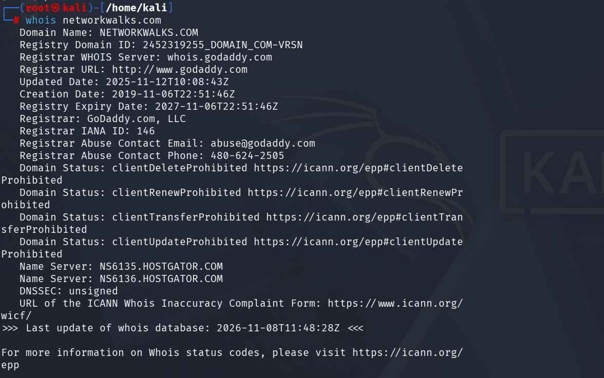
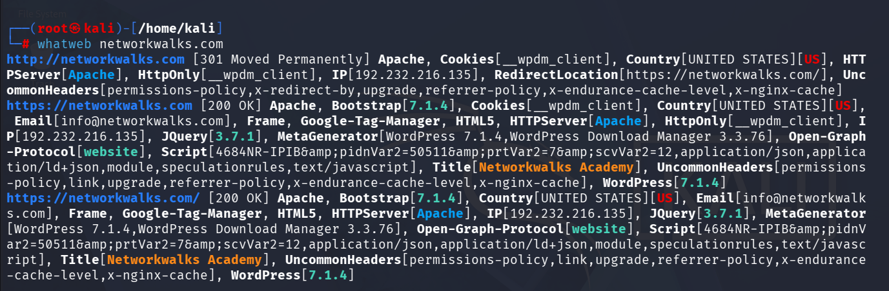
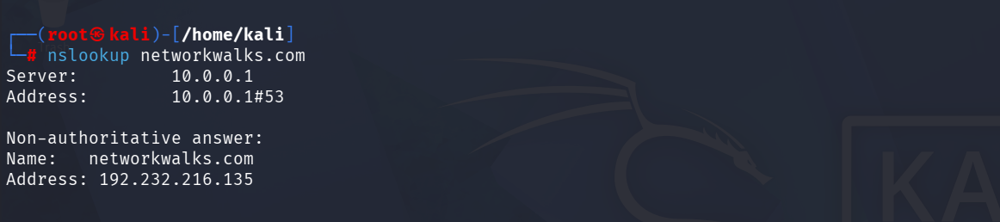
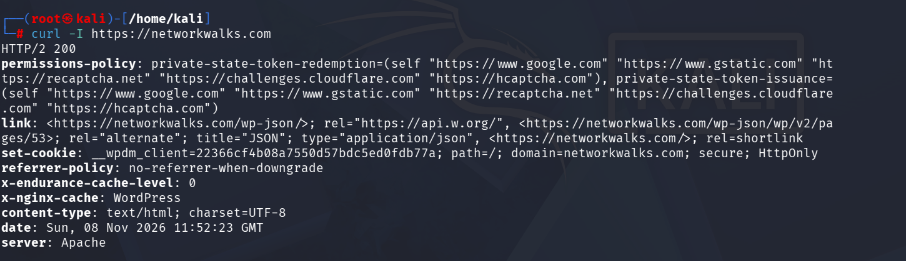
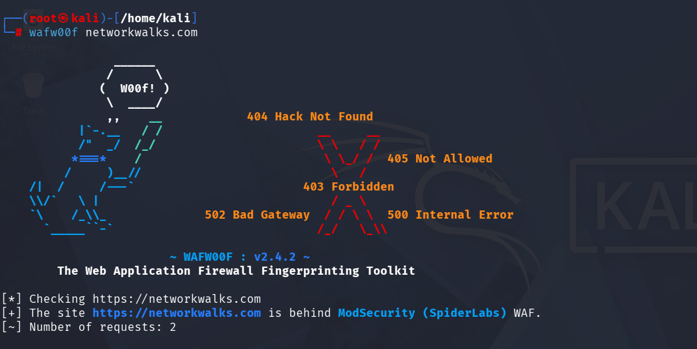
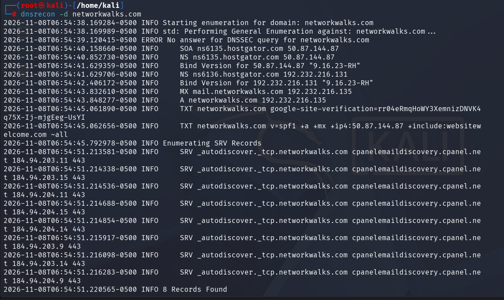
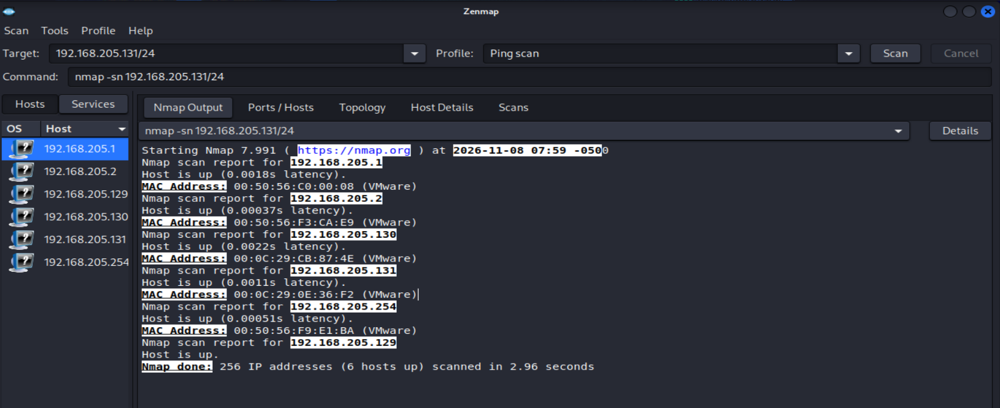
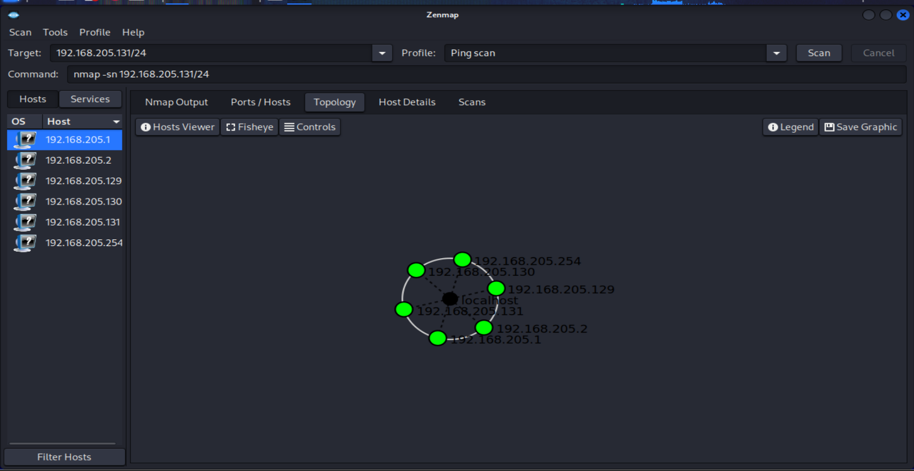

# Footprinting & Network Scanning: How I Did It

**Penetration Testing Phases 1-2 | Networkwalks Cybersecurity Internship, Batch B084 | Module W2-PM-FINAL**
**Author:** Awais Khan | **Date of testing:** 8 November 2026

This repository explains, step by step, how I completed my Week 2 practical. I footprinted a target
domain with six Kali Linux tools and scanned my own lab network with Zenmap. Every step has the exact
command, my screenshot, what I observed, and why it matters. The full report is here:
[`report/Pentest_Report_Footprinting_and_Scanning.pdf`](report/Pentest_Report_Footprinting_and_Scanning.pdf)

---

## Table of Contents

1. [Permission and scope](#1-permission-and-scope)
2. [Tools and setup](#2-tools-and-setup)
3. [Phase 1: Footprinting & Reconnaissance](#3-phase-1-footprinting--reconnaissance)
4. [Phase 2: Network Scanning with Zenmap](#4-phase-2-network-scanning-with-zenmap)
5. [Risk summary](#5-risk-summary)
6. [Recommendations](#6-recommendations)
7. [What I learned](#7-what-i-learned)
8. [Repository structure](#8-repository-structure)
9. [Disclaimer](#9-disclaimer)

---

## 1. Permission and scope

Penetration testing is only legal and ethical with **written permission from the owner** of the target.
Before running any command, I confirmed what I was allowed to test.

| Target | Basis for permission |
|---|---|
| `networkwalks.com` (public website and its DNS records) | Written authorization from Networkwalks, the owner (letter in Appendix A of the report) |
| My own local lab network (`192.168.205.0/24`) | I own and control it |

**Allowed (Phases 1 and 2 only)**
- Footprinting with passive or light tools: `whois`, `whatweb`, `nslookup`, `curl`, `wafw00f`, `dnsrecon`
- Host discovery with a Zenmap/Nmap ping scan of my own subnet

**Not allowed**
- Exploitation, unauthorized access or privilege escalation
- Denial of service, brute force, password attacks, or anything that could disrupt a service
- Accessing, copying, changing or deleting data that belongs to the client or a third party
- Social engineering, or testing any system outside the scope above

**Conditions I followed:** stop immediately if asked, keep findings confidential, use them only for the
internship, work only within the authorization dates, and act lawfully at all times.

---

## 2. Tools and setup

| Tool | Purpose |
|---|---|
| Kali Linux | Operating system for all reconnaissance and scanning |
| WHOIS | Domain registration details |
| WhatWeb | Web technology fingerprinting |
| Nslookup | Resolve a domain name to an IP address |
| curl -I | Read HTTP response headers |
| wafw00f | Detect a Web Application Firewall |
| DNSRecon | Enumerate DNS records |
| Zenmap (Nmap GUI) | Discover live hosts and draw the network topology |

A Kali Linux virtual machine is enough. Internet access is needed for Phase 1, and a private lab network
for Phase 2. If Zenmap is not installed, `nmap -sn <subnet>` does the same job on the command line.

---

## 3. Phase 1: Footprinting & Reconnaissance

**Target:** `networkwalks.com`. Only passive and light information-gathering commands were used.

### Step 1: WHOIS

**Goal:** find out who registered the domain, when, and which name servers it uses.

```bash
whois networkwalks.com
```

**What I saw**
- Registrar: GoDaddy.com, LLC
- Created 6 November 2019, expires 6 November 2027
- Name servers: `NS6135.HOSTGATOR.COM` and `NS6136.HOSTGATOR.COM`
- DNSSEC: unsigned



**Why it matters:** it shows who manages the domain and where DNS is hosted, which tells an attacker
whose accounts and services are worth targeting.

### Step 2: WhatWeb

**Goal:** fingerprint the technologies the website uses.

```bash
whatweb networkwalks.com
```

**What I saw**
- Apache web server, IP `192.232.216.135`
- WordPress 7.1.4 and WP Download Manager 3.3.76
- jQuery 3.7.1, Google Tag Manager, and a public contact email on the page
- WhatWeb also listed "Bootstrap 7.1.4". That matches the WordPress version string, so I treated it as unverified.



**Why it matters:** exact CMS and plugin versions let an attacker look up known vulnerabilities for them.

### Step 3: Nslookup

**Goal:** turn the domain name into an IP address.

```bash
nslookup networkwalks.com
```

**What I saw**
- `networkwalks.com` resolves to `192.232.216.135` (non-authoritative answer)
- This is the same IP that WhatWeb reported



**Why it matters:** the IP address is the network location of the service and the starting point for further scanning.

### Step 4: Curl (HTTP headers)

**Goal:** read the response headers without downloading the page. `-I` sends a HEAD request.

```bash
curl -I https://networkwalks.com
```

**What I saw**
- `HTTP/2 200` from an Apache server
- A `link` header exposing the WordPress REST API at `/wp-json/`
- Caching headers from the hosting platform
- A cookie set with the `Secure` and `HttpOnly` flags
- No HSTS, CSP, X-Frame-Options or X-Content-Type-Options in the captured output



**Why it matters:** headers confirm the software stack and show which browser protections the site does and does not enforce.

### Step 5: Wafw00f

**Goal:** detect whether a Web Application Firewall sits in front of the site.

```bash
wafw00f networkwalks.com
```

**What I saw**
- The site is behind **ModSecurity (SpiderLabs)**
- Only 2 requests were needed



**Why it matters:** knowing the WAF product tells an attacker what filtering to expect. For the defender, it is a positive control.

### Step 6: DNSRecon

**Goal:** enumerate the domain's DNS records. `-d` sets the domain.

```bash
dnsrecon -d networkwalks.com
```

**What I saw**
- Name servers `ns6135.hostgator.com` and `ns6136.hostgator.com`, both disclosing BIND 9.16.23-RH
- Mail server `mail.networkwalks.com` at `192.232.216.135`
- An SPF record ending in `~all` (soft fail)
- 8 autodiscover SRV records pointing to cPanel
- No answer to the DNSSEC query, matching the "unsigned" WHOIS status



**Why it matters:** DNS data maps the mail and name-server setup and shows how easy email spoofing might be.

---

## 4. Phase 2: Network Scanning with Zenmap

**Scope:** only my own network, a private VMware subnet that I control.

### Step 1: Choose the target and profile

In Zenmap I entered the target `192.168.205.131/24` and selected the **Ping scan** profile. Zenmap runs:

```bash
nmap -sn 192.168.205.131/24
```

`-sn` means host discovery only: it checks which addresses answer and does **not** scan ports.
`/24` covers all 256 addresses in the subnet.

### Step 2: Run the scan and read the output

The scan checked **256 IP addresses** and found **6 hosts up** in **2.96 seconds**.



| IP address | MAC address | Vendor |
|---|---|---|
| 192.168.205.1 | 00:50:56:C0:00:08 | VMware |
| 192.168.205.2 | 00:50:56:F3:CA:E9 | VMware |
| 192.168.205.130 | 00:0C:29:CB:87:4E | VMware |
| 192.168.205.131 | 00:0C:29:0E:36:F2 | VMware |
| 192.168.205.254 | 00:50:56:F9:E1:BA | VMware |
| 192.168.205.129 | not shown | scanning machine |

Nmap does not print a MAC address for the machine it runs on, which is why `192.168.205.129` has none.
All the MAC addresses belong to VMware, which confirms this is a virtual lab network.

### Step 3: Generate the topology

I opened the **Topology** tab, used **Legend** to show the key, and **Save Graphic** to export the diagram.
The scanning machine appears as `localhost` in the centre with the discovered hosts around it.



**Why it matters:** host discovery is the first step of internal reconnaissance. An attacker would use the
list to decide which hosts to port-scan next. A defender runs the same scan to confirm that only expected
devices are on the network.

---

## 5. Risk summary

These are **observations from information gathering, not confirmed vulnerabilities**. No exploitation
or vulnerability validation was performed.

| # | Observation | Risk |
|---|---|---|
| 1 | WordPress 7.1.4 and WP Download Manager 3.3.76 version information exposed | Medium |
| 2 | DNS records and BIND 9.16.23-RH version visible on the name servers | Medium |
| 3 | Server IP, HTTP headers, REST API link and ModSecurity WAF identifiable | Low |
| 4 | Browser security headers not seen in the captured headers | Low |
| 5 | DNSSEC unsigned and SPF record ends in soft fail | Low |
| 6 | Public contact email visible on the home page | Low |
| 7 | Six live hosts on the lab subnet, all VMware | Low |

---

## 6. Recommendations

1. Hide or reduce CMS and plugin version information.
2. Keep WordPress core and plugins updated and review security advisories.
3. Restrict REST API exposure where it is not needed.
4. Add HSTS, CSP, X-Frame-Options and X-Content-Type-Options headers.
5. Hide the BIND version and consider enabling DNSSEC.
6. Review SPF, and add DKIM and DMARC.
7. Keep ModSecurity enabled and tuned.
8. Scan owned networks regularly and investigate unknown devices.
9. Only test with written authorization.

---

## 7. What I learned

- A lot can be learned about a target from public information alone, before any exploitation.
- Each tool answers a different question: who owns it, what runs on it, where it lives, what it exposes.
- A good report states what was done, what was found, what it means, the risk, and how to fix it.
- Authorization and scope come first, every time.

---

## 8. Repository structure

```
.
├── README.md
├── report/
│   └── Pentest_Report_Footprinting_and_Scanning.pdf
└── screenshots/
    ├── 01_whois.png
    ├── 02_whatweb.png
    ├── 03_nslookup.png
    ├── 04_curl.png
    ├── 05_wafw00f.png
    ├── 06_dnsrecon.png
    ├── 07_zenmap_ping_scan.png
    └── 08_zenmap_topology.png
```

---

## 9. Disclaimer

I performed these activities only on systems for which I held written permission, or that I own. This
material is for education and research only. Do not use anything here against a system you do not own or
have written permission to test. The author and Networkwalks are not responsible for misuse. Unauthorised
access is a crime in most countries, even when nothing is damaged.
